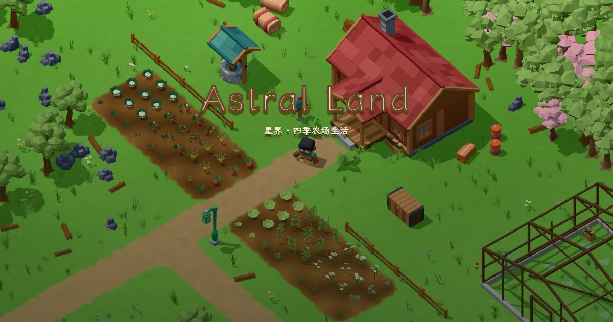
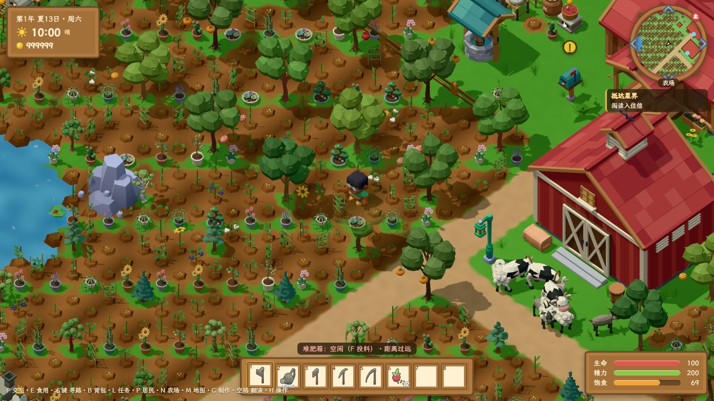
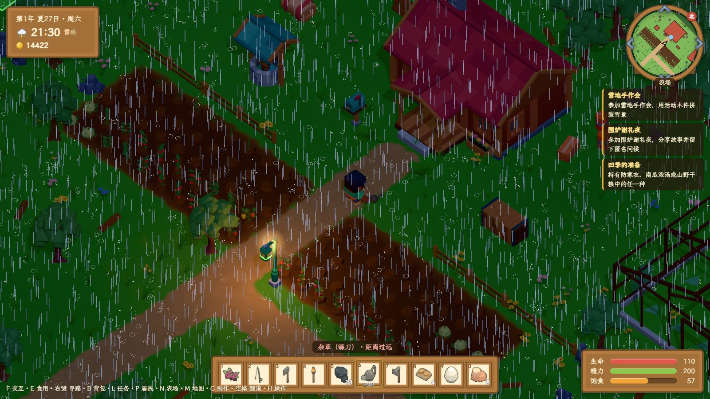
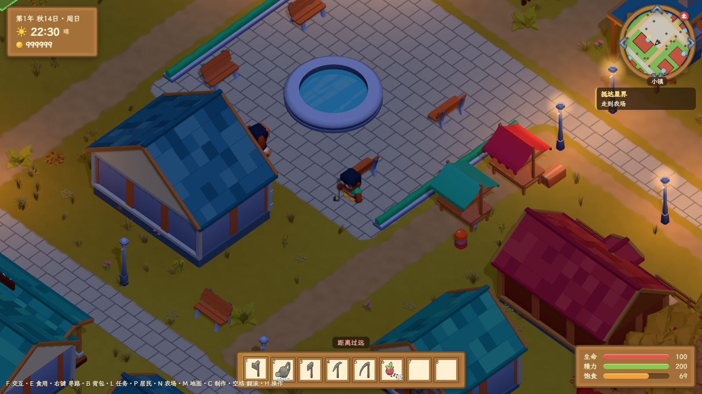
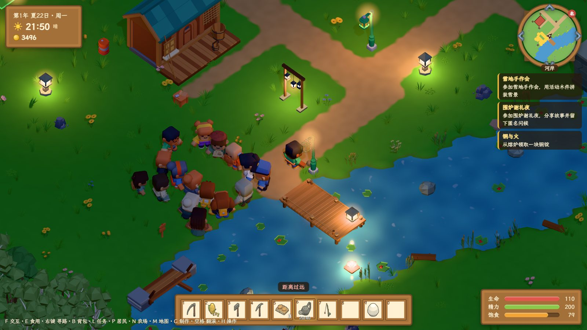
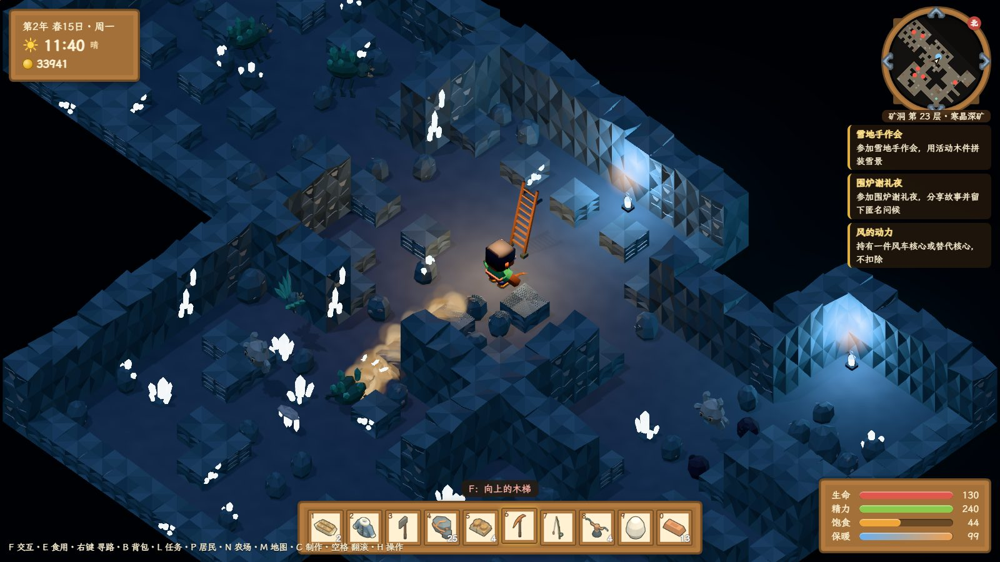
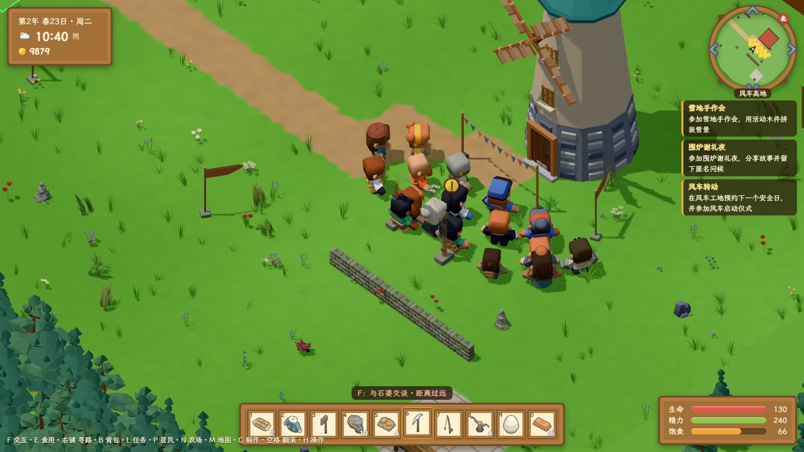
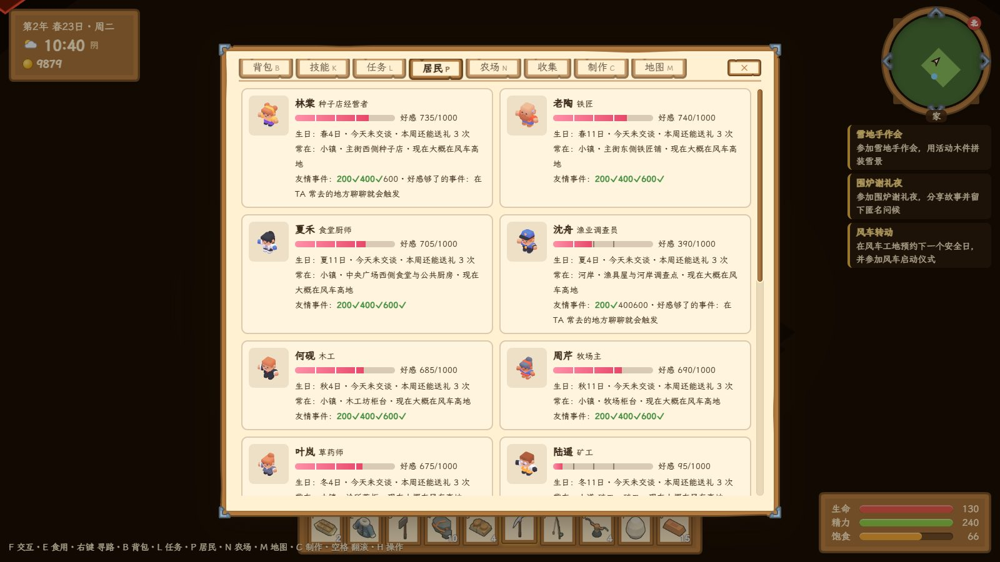
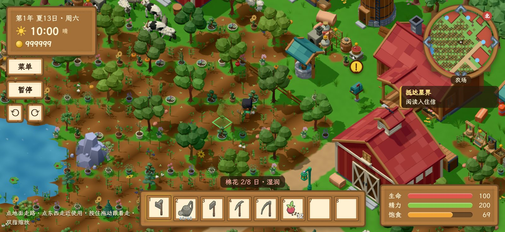

<p align="center">
  
</p>

<h1 align="center">星界 Astral Land</h1>

<p align="center">
  在浏览器里经营一座四季农场：种田、钓鱼、下矿、过节，和谷地里的十六位邻居一起把小镇修好。<br>
  打开网页就能玩，不用安装；电脑、手机、手柄都能玩，也能离线游玩。
</p>

<p align="center">
  <a href="https://github.com/mlt131220/AstralLandGame"></a>
  <a href="https://gitee.com/mlt131220/AstralLandGame"></a>
</p>

<p align="center">中文 | <a href="README.en.md">English</a></p>

---

## 游戏简介

你收到一封来自星界谷地的信：一块荒了很久的农场，从今天起归你照料。开垦、播种、浇水、收获，把作物送去出货；在小镇认识居民、参加节庆；进山采集、下矿冒险；再和大家一起修好水闸、林桥、驿站和温室，让高地上的老风车重新转起来。主线结束后，在愿望簿上写下你想过的日子，然后继续经营下去。

游戏使用 [Three.js](https://threejs.org/) 的 WebGPU 渲染器，低多边形 3D、斜 45 度俯视视角，界面是木框羊皮纸风格。

## 特色

- **四季农场**：28 种作物，开垦、播种、浇水、收获、出货；铜级以上的锄头和水壶可以蓄力一次处理多格；喷灌、温室让农场越种越大。
- **会变化的世界**：昼夜交替，黄昏路灯渐亮；雨滴落地溅起水花、落进河里荡开涟漪，冬天下雪，夏夜有雷雨。
- **16 位居民**：每人有自己的日程、喜好和三段友情事件；交谈、送礼，接他们的委托。
- **8 场节庆**：花种会、河岸开钓日、长日野餐、萤灯夜、田野集市、丰收协作日、雪地手作会、围炉谢礼夜，每场都有自己的小游戏。
- **冒险**：钓鱼小游戏、山林与湿地采集，30 层矿洞（苔石浅矿、旧铁矿、寒晶深矿）和 3 场首领战，短剑、长柄、轻弓三种武器。
- **经营与生活**：鸡、鸭、兔、牛、羊、山羊，熔炉、烘干架、果酱锅等十多种加工机器，烹饪 20 多道料理；布置自己的家、换装，还能养一只猫或狗。
- **共建谷地**：主线 24 章，和居民一起完成水闸、林桥、驿站、温室和风车五项公共工程，举办风车启动仪式与长桌宴。
- **随时随地**：浏览器即开即玩；支持手机触屏（点哪走哪、点哪用哪）、手柄、离线游玩；中文 / English。

## 截图

| | |
| --- | --- |
|  |  |
| 经营成型的农场 | 夏夜雷雨：雨滴溅起水花、池塘荡开涟漪 |
|  |  |
| 入夜后小镇的路灯 | 节庆“萤灯夜”：河面上的灯 |
|  |  |
| 寒晶深矿 | 修好的风车与启动仪式 |
|  |  |
| 菜单里的居民页：好感、生日与常去的地方 | 手机横屏触屏操作 |

## 开始游玩

### 浏览器要求

游戏只支持带 **WebGPU** 的浏览器：

- 电脑：最新版 Chrome 或 Edge（推荐），Safari 26 及以上；Firefox 目前只在部分平台开启了 WebGPU。
- 手机与平板：安卓上的最新版 Chrome，iPhone / iPad 上的 Safari 26 及以上。手机请横屏游玩。
- 需要开启浏览器的“硬件加速”。打不开时，标题页会提示是浏览器不支持 WebGPU、拿不到显卡，还是加载出错。

### 存档与隐私

- 不需要账号。存档只保存在你自己的浏览器里，每 30 秒、换区域和睡觉后自动保存；暂停菜单里可以导出存档文件，在标题页导入。
- 第一次打开后，游戏会在后台把完整资源包下载到浏览器缓存，之后断网也能玩。
- 游戏不收集任何个人数据，详见 [隐私说明](public/privacy.html)。

### 试玩存档

想直接体验中后期内容，可以用仓库里准备好的存档：在标题页点“进入游戏”，在存档列表下方点“导入存档文件”，选择下面的文件。游戏有 3 个存档位，导入会占用一个空位。

| 存档 | 内容 |
| --- | --- |
| [`summer-firefly-night.json`](public/saves/summer-firefly-night.json) | 第 1 年夏 22 日，当天是节庆“萤灯夜”（18:00 在河岸开场） |
| [`mine-floor-25.json`](public/saves/mine-floor-25.json) | 第 2 年春 15 日，矿洞已到 29 层，可坐电梯到 25 层，30 层首领还没打 |
| [`windmill-ceremony.json`](public/saves/windmill-ceremony.json) | 第 2 年春 23 日，风车已修好，当天在高地举行启动仪式（10:00—17:00 入场） |
| [`full-farm.json`](public/saves/full-farm.json) | 种满作物、机器和动物的农场，用来测试性能 |

## 操作

| 动作 | 键盘鼠标 | 手柄（Xbox 布局） | 手机触屏 |
| --- | --- | --- | --- |
| 移动 | WASD，Shift 冲刺 | 左摇杆 / 十字键，RT 冲刺 | 点地面自动走过去；按住拖动，角色朝手指走 |
| 使用工具或物品 | 鼠标左键（按住蓄力） | A（按住蓄力） | 点作物、石头、树等目标，走近后自动使用；按住身边目标蓄力 |
| 交互（对话、开门、商店） | F | X | 点人、门、柜台、机器 |
| 自动寻路 | 鼠标右键点目标格 | — | 点地面 |
| 选快捷栏 | 数字键 1—0 | LB / RB | 点快捷栏格子 |
| 吃东西 | E | — | 选中食物后点“食用” |
| 翻滚 | 空格 | LT | “翻滚”按钮 |
| 菜单 | B 背包、K 技能、L 任务、P 居民、N 农场、C 制作、M 地图 | Y 背包、Back 地图 | “菜单”按钮 |
| 镜头 | Q / R 旋转 90°，滚轮缩放 | 右摇杆 | 双指缩放，旋转按钮 |
| 暂停 | Esc | Start | “暂停”按钮 |

游戏中按 H（或暂停菜单里的“操作说明”）可以随时查看。

## 本地开发

### 环境

- [Node.js](https://nodejs.org/) 23.6 及以上（测试直接用 Node 运行 TypeScript 文件）
- [pnpm](https://pnpm.io/) 10
- 一个支持 WebGPU 的浏览器

### 常用命令

```bash
pnpm install      # 安装依赖
pnpm dev          # 开发服务器 http://localhost:5173
pnpm test         # 规则与内容自检（9 套测试）
pnpm build        # 类型检查 + 生产构建，输出到 dist/
pnpm preview      # 本地预览生产构建 http://localhost:4173
```

### 项目结构

```text
src/
  core/       领域层：状态、规则、任务、战斗、存档迁移（不依赖 Three.js 和 DOM，可以直接在 Node 里测试）
  content/    内容数据：作物、物品、居民、任务、节庆，以及 i18n 词典
  render/     Three.js WebGPU 渲染层：场景、模型、角色动画、天气粒子
  ui/         Vue 3 界面：HUD、菜单、对话、商店、节庆小游戏
  platform/   浏览器平台：存档、离线包、音频、手柄、触屏、设置
  game.ts     游戏主循环与输入
public/       运行时资源（模型、图标、音频、字体）、Service Worker、隐私说明、试玩存档
scripts/      开发脚本（翻译检查）
docs/         截图与素材授权台账
```

### 测试

`pnpm test` 覆盖农务与经济规则、任务链能否全部完成、存档往返与迁移、离线包更新与回滚、英文翻译是否齐全等。翻译有问题时，`node scripts/i18n-scan.mjs` 会列出缺的词条、用不到的键和源码里的中文字面量。

调试：网址后加 `?perf`（开发模式下不用加），浏览器控制台里可以用 `astral()` 读写游戏状态，例如 `astral().s.min = 1080` 把时间调到 18:00。

### 多语言

界面文字一律写成 `t('区域.名字', 参数)`（`src/core/i18n.ts`），中文在 `src/content/i18n/zh.json`，英文在 `en.json`，两份用同一套键；内容数据的英文按 id 放在 `src/content/i18n/en/`。新增文字必须中英都写，否则 `pnpm test` 会失败。

## 构建与部署

`pnpm build` 生成的 `dist/` 是纯静态文件，可以放到任意静态托管（GitHub Pages、Cloudflare Pages、Netlify、Nginx 等）：

- 必须用 **HTTPS**（WebGPU 和 Service Worker 都要求安全上下文）。
- 部署在域名根路径（资源用 `/assets/...` 绝对路径）。
- `sw.js` 和 `offline-manifest.json` 不要长期缓存，其余带哈希的文件可以长期缓存。
- 构建时会生成离线包清单（约 1700 个文件、120 MB），玩家第一次打开后在后台下载；发布新版本后，玩家下次打开页面时自动换用新版，正在玩的页面不会混用新旧资源。

## 美术与音频资源

- 游戏运行用到的模型、贴图、音频和字体都在 `public/assets`，克隆后即可构建运行。
- 项目自制的模型（建筑、作物、农具、生物、家具等）由 Blender 脚本程序化生成，第三方素材来自 Kenney 与 OpenGameArt。
- 每项资源的来源与许可记录在 [`docs/ASSET_LEDGER.md`](docs/ASSET_LEDGER.md)。

## 致谢

- [Kenney](https://kenney.nl/)：场景、角色、宠物、图标等 3D 模型与界面素材（CC0）
- SubspaceAudio、Zane Little、cynicmusic、Yoiyami、trex0n、tinyworlds 等作者在 [OpenGameArt](https://opengameart.org/) 发布的音乐与音效（CC0）
- [霞鹜文楷 LXGW WenKai](https://github.com/lxgw/LxgwWenKai)：界面字体（SIL Open Font License 1.1）
- [Three.js](https://threejs.org/)、[Vue](https://vuejs.org/)、[Vite](https://vite.dev/)

## 许可

- 代码与项目自制资源：[MIT](LICENSE)
- 第三方资源保留各自的许可：Kenney 与 OpenGameArt 素材为 CC0 1.0，霞鹜文楷字体为 SIL OFL 1.1。
